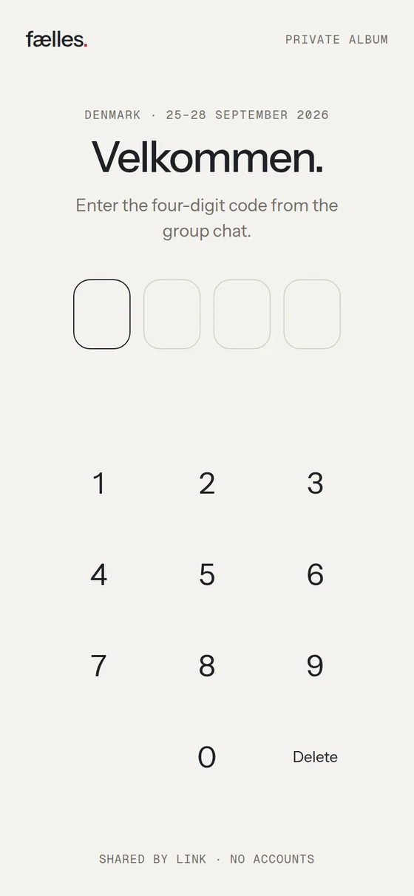
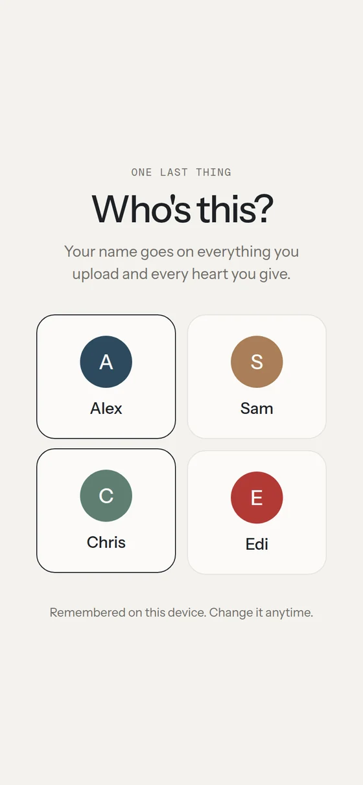
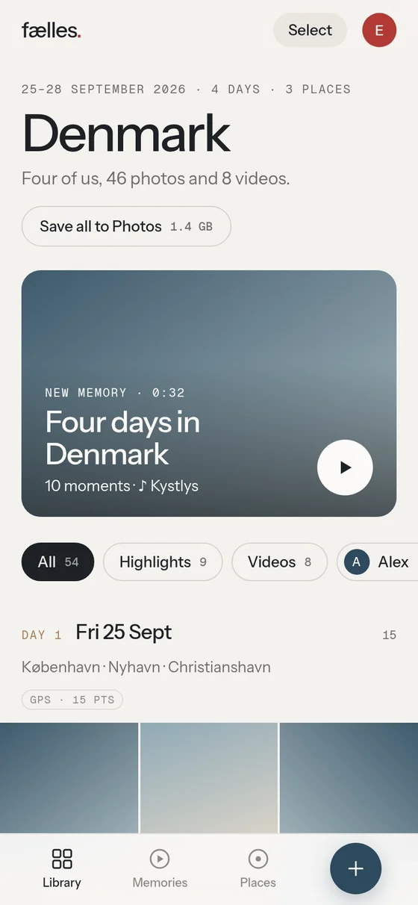
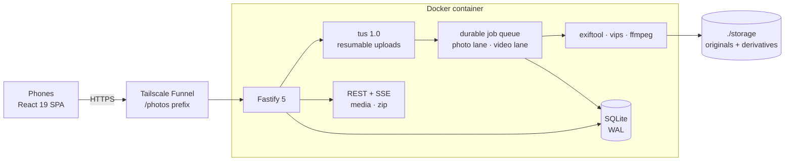

<div align="center">


<sub><a href="#-what-it-is">What it is</a> &nbsp;·&nbsp; <a href="#-features">Features</a> &nbsp;·&nbsp; <a href="#-architecture">Architecture</a> &nbsp;·&nbsp; <a href="#-engineering-notes">Engineering notes</a> &nbsp;·&nbsp; <a href="docs/OPERATIONS.md">Operations</a></sub>

</div>

<br/>

> Four friends, four days in Denmark, two iPhones and two Androids. Instead of a group chat that compresses
> everything, one link and one four-digit PIN open a shared library of **originals**: uploads that survive
> roaming data and locked screens, HEIC and HDR video that just work, and a generated "memory" film with its own soundtrack at the end of each day.

<br/>

<table>
  <tr>
    <td width="33%"></td>
    <td width="33%"></td>
    <td width="33%"></td>
  </tr>
</table>

<sub>UI design prototype (<code>design/</code>) with placeholder members and imagery; the production app implements this design.</sub>

## ◆ &nbsp;What it is

A self-hosted, mobile-first album for a single trip: one Fastify process, one SQLite file, one storage folder,
in one Docker container. No accounts and no cloud. Everyone opens the same link, enters the PIN, picks their name once,
and from then on every upload, heart and caption is attributed to them.

## ◆ &nbsp;Features

<table>
  <tr>
    <td width="33%" valign="top">
      <h4>⬆️ Uploads that finish</h4>
      <p>Resumable tus uploads; on Android, Background Fetch keeps them going with the app minimised or the tab closed, resuming from the server offset if anything stalls.</p>
    </td>
    <td width="33%" valign="top">
      <h4>🖼️ Real media pipeline</h4>
      <p>exiftool metadata, vips WebP thumbnails and display copies, ffmpeg posters and H.264 previews with HDR→SDR tone-mapping, so iPhone HEIC and HLG video just work.</p>
    </td>
    <td width="33%" valign="top">
      <h4>🎞️ Memories</h4>
      <p>Moments scored by hearts and highlights, sampled per day and played full-bleed with a generative Web Audio soundtrack whose mood follows the city.</p>
    </td>
  </tr>
  <tr>
    <td width="33%" valign="top">
      <h4>📍 Places &amp; days</h4>
      <p>GPS points grouped into places on a MapLibre map; the library is organised by trip day with inline day captions.</p>
    </td>
    <td width="33%" valign="top">
      <h4>⚡ Live &amp; social</h4>
      <p>Server-Sent Events push new items to every phone instantly; hearts, highlights, per-person filters and multi-select.</p>
    </td>
    <td width="33%" valign="top">
      <h4>💾 Get originals out</h4>
      <p>"Save all to Photos" or a streamed ZIP of untouched originals with an exact Content-Length, so downloads show real progress.</p>
    </td>
  </tr>
</table>

## ◆ &nbsp;Architecture



| Layer | Stack |
|---|---|
| Frontend | React 19, Vite 7, Zustand, MapLibre GL, tus-js-client, Phosphor icons, Instrument Sans + Geist Mono |
| Backend | Node 22, Fastify 5, @tus/server 2, better-sqlite3 (WAL, foreign keys on), yazl streaming ZIP |
| Media | exiftool, libvips (vips-heif), ffmpeg on Alpine 3.22, `tini` as PID 1, non-root user |
| Quality | Vitest unit and integration suites (146 tests), Python Playwright e2e at 390×844 and 1440×900 |

The full design (storage layout, auth and throttling, upload flow, metadata rules, queue, SSE, memories, audio engine,
places logic) is documented in **[PLAN.md](PLAN.md)**.

## ◆ &nbsp;Engineering notes

- **Prefix-agnostic routing.** The app works whether the `/photos` prefix is stripped by the proxy or passed through, verified in both modes.
- **iOS photo picking.** Each pick gets its own file input that survives until upload, because iOS can take a while to copy originals out of the library.
- **Android background uploads.** After a small tus `POST`, bytes go to the browser's download manager as one `PATCH`; files are copied into plain Blobs first because Chrome sends empty bodies for input-backed Files.
- **iOS 26 HEIC.** Alpine 3.22 ships libheif 1.19, which decodes the auxiliary image references that libheif 1.17 rejected.
- **Capture time you can trust.** Timestamps resolve from EXIF/QuickTime tags with offset handling, tested against synthetic fixtures for each phone family.
- **Safety rails.** PIN attempts are throttled, a disk-free guard refuses new uploads before the volume fills, and stale partial uploads are purged.

## ◆ &nbsp;Run it

```sh
FAELLES_PIN=1234 docker compose up -d --build   # 127.0.0.1:8497
```

Backups, changing the PIN, exposing it over Tailscale Funnel, the dev backend and troubleshooting are in the
**[operations guide](docs/OPERATIONS.md)**.

## ◆ &nbsp;Tech


<br/>

<div align="center">
<sub>Built by <a href="https://github.com/LikeMyCoffe"><b>Eduard-Florentin Enache</b></a> &nbsp;·&nbsp; Data · BI · AI product builder</sub>

</div>
